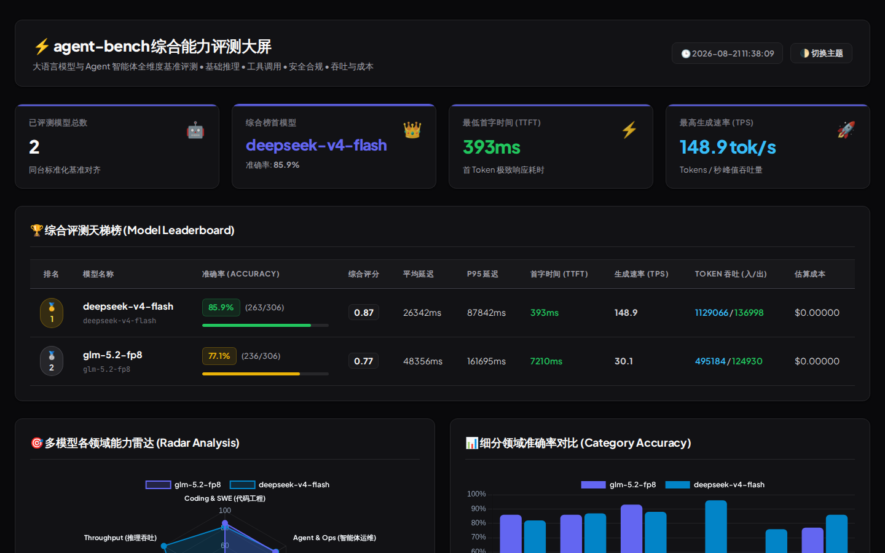
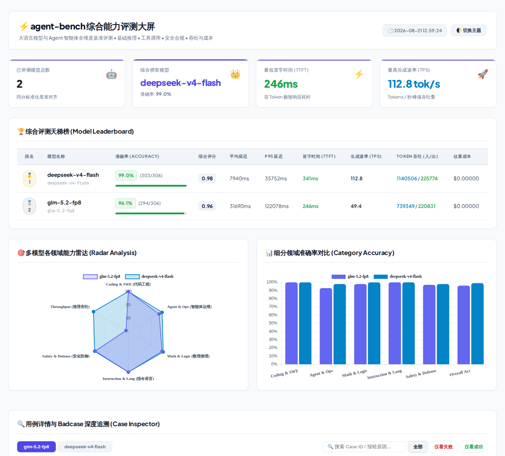

# 🦀 agent-bench: 可扩展的大模型与 Agent 评测框架

`agent-bench` 是一个基于 **Rust** 的模块化评测框架，包含多协议模型适配、Agent 轨迹执行、规则/Judge 判定、报告导出和 Vue 3 可视化大屏。

> **定位说明**：这是一个工程化评测框架/可视化原型，不是“官方权威认证系统”。内置探针、基线库和数据集都有明确局限；请阅读文末的 [限制与诚实声明](#限制与诚实声明)。

<div align="center">
  
</div>

<details>
  <summary><b>☀️ 点击展开浅色模式大屏 (Light Mode Preview)</b></summary>
  <br/>
  
</details>

## ✨ 核心能力

- **11 个公开 benchmark 数据文件 / 1,514 条用例（v2）**：
  - Foundation 1,064：MATH-500 300、GSM8K 150、HumanEval 164、MBPP 150、IFEval 100、MMLU-Pro 150、LongBench 50。
  - Agent 100：BFCL v4 simple_python 单轮函数调用（适配为函数名/参数匹配判定）。
  - Domain 150：MMLU 医学/法律/金融/科学/人文各 30。
  - Safety 200：TruthfulQA 100、HarmBench 100。
  - 真实 Web/SQLite 工具已实现：`search_web` 需 `AGENT_BENCH_SEARCH_ENDPOINT`；`database_query` 查询 workspace 内只读 SQLite。
  - 难度按数据源/抽样规则标注：L2 500、L3 585、L4 205、L5 224；L4+L5 共 **429** 条。
  - 每条用例带 `metadata.source_dataset/source_revision/license/official_metric`；`datasets/MANIFEST.json` 记录来源 URL、revision、许可、SHA256、抽样种子。
  - 数据由 `tools/build_public_datasets.py` 可复现生成；是公开 benchmark 的**抽样子集**，不是全量官方 leaderboard。
- **Agent 执行**：Bash/文件/grep/calculator、只读 SQLite 查询、配置化 SearXNG 搜索、多轮 ReAct、工具轨迹记录、测试命令验证、轨迹 Judge。
  - `database_query` 在 workspace 内真实 SQLite（默认 `data/bench.db`）执行只读 SELECT/WITH；拒绝写、ATTACH、PRAGMA 和路径逃逸。
  - `search_web` 只在显式设置 `AGENT_BENCH_SEARCH_ENDPOINT`（SearXNG 兼容 JSON）时工作；未配置直接报错，不返回假结果。
- **多协议适配**：OpenAI Chat Completions、OpenAI Responses、Anthropic Messages、Gemini、Mock。
- **隔离执行**：
  - Linux 下使用 **bubblewrap (`bwrap`)**：host 根只读、仅 workspace 可写、无网络、独立 PID/mount/user namespace、清空环境变量、进程组超时 kill。
  - CodeExecution 同样在 bwrap 中运行，并阻断 `sys.exit`/`os._exit` 跳过测试的路径。
  - 未安装 bwrap 时默认拒绝执行；只有显式设置 `AGENT_BENCH_ALLOW_UNSANDBOXED=1` 才会降级运行（不建议）。
- **判分**：
  - exact_match 只接受精确匹配或数值等价，**不做子串匹配**。
  - regex 支持 `metadata.must_not_match` 负约束。
  - LLM Judge 使用独立 system prompt、不可信数据边界和 JSON 校验；解析失败直接失败，不做关键词猜测。
  - 硬规则失败不会再被 Judge “翻盘”。
- **多信号证据核验（不是“正品认证”）**：
  - 6 个固定探针 + 5 个动态对抗探针（含鹈鹕骑自行车动态 SVG）+ 2 次交叉审讯 + 可选的 GSM8K/MMLU 小样本 benchmark 交叉核验。
  - 输出统一 `signals[]` 证据矩阵与 `evidence_score`；裁定只有 `Consistent / Suspicious / Inconclusive / HighRisk`，不再输出 `Authentic`。
  - 可选独立 LLM auditor 只提供点评，不改变确定性通过/失败；公开 benchmark 小样本是能力证据，不是身份证明。
  - 未生成 verified 基线漂移时 **不伪造“实测基线分”**；基线库中 `verified=false` 的条目只展示、不参与判定。
- **可视化大屏**：排行榜、模型/渠道对比、用例检查、Pareto、雷达图、实时运行。
  - 默认绑定 `127.0.0.1`，启动时生成访问 token；浏览器通过 HttpOnly + SameSite=Strict Cookie 认证。
  - 默认禁止 Web 请求覆盖 `base_url/api_key/protocol`；如确需自定义端点，启动时加 `--allow-custom-endpoints`，且自定义 `base_url` 必须同时提供显式 `api_key`，Web 请求不允许 `env:` 形式。
- **报告**：JSON / Markdown / HTML（数据内嵌；图表依赖 CDN，离线时图表不可用）。

## 🚀 快速上手

### 1. 依赖

- Rust 1.80+（workspace 使用 edition 2021）
- Linux + `bubblewrap`（Agent/CodeExecution 沙箱）
- Python 3（运行 Python 任务/测试）
- Node 18+（仅构建前端时需要）

```bash
# Debian/Ubuntu
sudo apt-get install bubblewrap python3
cargo build --release
```

### 2. 校验数据集（CI 门禁）

```bash
cargo run --bin agent-bench -- validate datasets
# 有错误时返回非 0；当前仓库 1,514 条应返回 0。
```

### 3. 配置真实模型

`eval_config.toml` 被 `.gitignore` 忽略，需要从示例复制：

```bash
cp eval_config.example.toml eval_config.toml
# 编辑 models/judge，并把密钥放在环境变量里：
export OPENAI_API_KEY=...
export ANTHROPIC_API_KEY=...
```

### 真实工具配置（可选）

```bash
# 真实搜索：只访问这个由运维配置的 SearXNG 兼容 JSON 端点；未配置时工具明确报错，不返回 fixture。
export AGENT_BENCH_SEARCH_ENDPOINT=http://127.0.0.1:8080/search
export AGENT_BENCH_SEARCH_API_KEY=optional-bearer-token

# SQLite：每个 workspace 初始化 data/bench.db（users/orders 样例表），database_query 用只读连接执行 SELECT/WITH。
```

数据再生成（需要网络、`datasets`/`huggingface_hub`）：

```bash
python3 tools/build_public_datasets.py --out datasets
cargo run --bin agent-bench -- validate datasets
```

`[judge]` 是可选的；没有 judge 时：
- `llm_judge` 类型会失败并给出明确原因（不会回退到 exact_match）；
- `agent_trajectory` 中依赖 criteria 的主观题按规则评分为 0；
- 代码/数学等硬规则题仍可独立评测。

### 4. 运行评测

```bash
# 全量评测
cargo run --bin agent-bench -- run --config eval_config.toml

# 过滤类别 / 难度 / 评测类型
cargo run --bin agent-bench -- run --config eval_config.toml --category agent --limit 20
cargo run --bin agent-bench -- run --config eval_config.toml --category foundation --limit 20
cargo run --bin agent-bench -- run --config eval_config.toml --frontier --limit 20
cargo run --bin agent-bench -- run --config eval_config.toml --eval-type multiple_choice
cargo run --bin agent-bench -- run --config eval_config.toml --eval-type tool_call
cargo run --bin agent-bench -- run --config eval_config.toml --eval-type code_execution

# 无配置时的显式 Demo（不会静默用 mock 冒充真实模型）
cargo run --bin agent-bench -- run --mock --limit 20

# 断点续跑：读取旧结果，重跑失败用例，并把新结果合并回原模型结果
cargo run --bin agent-bench -- run --config eval_config.toml \
  --resume-failed results/eval_results_YYYYMMDD_HHMMSS.json

# 随机抽样
cargo run --bin agent-bench -- run --config eval_config.toml --sample-ratio 0.2 --seed 42
```

- 多模型并发有一个全局 `concurrency` 上限（不是每模型各一份）。
- 某个模型失败时会先保存成功模型的结果，然后以非 0 退出；不会再静默丢弃失败模型。
- `--resume-failed` 要求结果文件存在且可解析；找不到会直接报错。

### 5. 历史结果与 Elo

```bash
cargo run --bin agent-bench -- compare results/
```

Elo 是“同题逐题比较”的粗略分，不是人类投票 Elo；不同运行集/不同题集之间的分数不可直接比较，且结果对题目顺序敏感。仅作参考。

### 6. 可视化大屏

```bash
cargo run --bin agent-bench -- dashboard --port 5173 --results results/
```

启动后终端会打印：

```text
http://127.0.0.1:5173/?token=<一次性令牌>
```

- 默认只监听 `127.0.0.1`；`--host 0.0.0.0` 会扩大暴露面，请自行加防火墙/反代。
- 打开带 token 的 URL 后，服务端写入 HttpOnly Cookie 并 302 到 `/`。
- API 还支持 `X-Auth-Token`/`Authorization: Bearer <token>`（便于 curl）。
- 默认拒绝跨站 POST，且响应不再带 `Access-Control-Allow-Origin: *`。
- 自定义端点：`dashboard --allow-custom-endpoints`；Web 请求不允许 `api_key=env:...`，且自定义 base_url 必须显式给 api_key，避免把服务端配置密钥转发到任意 URL。

### 7. 模型验真

```bash
# 静态探针（确定性；不会伪造 baseline drift）
cargo run --bin agent-bench -- verify -c eval_config.toml \
  -m deepseek-v4 -t DeepSeek-V4 --json

# 动态对抗 + 可选 LLM 点评（使用 config 中的 [judge]）
cargo run --bin agent-bench -- verify -c eval_config.toml \
  -m claude-opus-5-5 -t Claude-Opus-5.5 --agentic

# 无配置文件时显式用 mock 演示
cargo run --bin agent-bench -- verify -m mock-pro -t DeepSeek-R1 --json
```

再次强调：探针通过只是“该端点能正确回答这些固定题”的弱证据，**不能证明没有被中转商伪造**；它也不是密码学证明。

### 8. 测试

```bash
cargo test --workspace
cargo clippy --workspace --all-targets
cargo fmt --all -- --check
```

前端：

```bash
cd web
npm install
npm run build
```

## 📁 目录结构

```text
agent-bench/
├── Cargo.toml
├── crates/
│   ├── eval-core/        # Provider、数据加载、判定、指标、报告、沙箱、基线
│   ├── eval-agent/       # 工具执行、workspace、轨迹、动态对抗审计
│   ├── eval-suites/      # 并发编排、取消、部分失败、Elo
│   └── eval-cli/         # CLI、Dashboard Web 服务、验真命令
├── datasets/             # 11 个公开 JSONL（1,514 条）+ MANIFEST/README
├── web/                  # Vue 3 + Vite 大屏
└── eval_config.example.toml
```

## 🔐 安全边界

- 沙箱边界：`bwrap` namespace + 只读 host + 仅 workspace 可写 + 无网络 + 环境变量白名单 + 进程组 kill。
- 文件 API 边界：拒绝绝对路径、`..`、反斜杠、NUL、symlink 组件；写入使用 `O_NOFOLLOW`。
- 测试完整性：数据集中的 test 文件在验证前从快照恢复；验证后校验未被修改；移除 `unittest.py`/`conftest.py` 等影子模块。
- Dashboard：token + HttpOnly SameSite Cookie + 同源检查 + 路径 canonicalize + 1MB body 上限 + 连接数上限。
- 真实工具边界：`database_query` 只读且限制在 workspace；`search_web` 只访问运维配置的端点，不接受模型提供 URL；沙箱内 `bash` 仍默认断网。
- 仍然存在的风险：同一用户下的并发 case 共享 `/tmp`；bwrap 依赖宿主内核/发行版；自定义端点模式是有意放宽；LLM Judge/审计本身不可信；静态探针不能证明身份。

## 限制与诚实声明

1. **数据是公开 benchmark 的抽样子集，不是全量官方 leaderboard**：HumanEval/MBPP/MMLU/MMLU-Pro/TruthfulQA/GSM8K/MATH-500/LongBench/HarmBench/BFCL/IFEval 均记录来源、许可、版本和哈希；MATH-500、HarmBench 使用 LLM Judge 适配，LongBench 使用 token-F1 阈值（短答完全包含于参考时通过），BFCL 使用函数名/参数匹配适配，IFEval 使用 21 类确定性规则子集，不能直接对标官方分数。
2. **难度是启发式**：L2–L5 按来源/ID 规则标注，已写入 `difficulty` 字段以保证筛选与统计一致；不是人工校准的认知难度。当前 L4+L5 = 429；总计 1,514 条（含 BFCL L2 100 与 IFEval L2 100）。
3. **验真不是认证**：自报身份、固定探针、动态题都可以被中转商针对性适配；`verified=false` 的基线不做漂移判定；没有运行 benchmark 时绝不生成“实测基线分”。
4. **Judge 不是 ground truth**：LLM Judge 可能被注入、偏好冗长答案或给出不一致分数；代码中已加边界/校验/成本记录，但仍需人工抽检。
5. **Elo/Composite 是参考指标**：加权、Elo、efficiency index 都是启发式；不同题集/运行之间不可直接比较。
6. **真实 Web/SQLite 工具的边界**：`search_web` 需要运维配置 `AGENT_BENCH_SEARCH_ENDPOINT`（SearXNG 兼容 JSON），未配置时明确报错、不返回 fixture；`database_query` 只允许 workspace 内 SQLite 的只读 SELECT/WITH（默认 `data/bench.db`），不支持写/ATTACH/PRAGMA。
7. **前端**：不再在 API 失败时生成模拟验真报告，也不再合成渠道数据；基线库从 `/api/baselines` 加载，并显示 `verified` 标记。若后端不可用，页面显示错误/空态，而不是伪造数据。
8. **长上下文/指令遵循**：v2 的 LongBench 子集是约 4.5k–202k 字符真实长文（中位约 51k），使用 token-F1 阈值并允许短答 containment；IFEval 只接入 21 类可确定性检查的指令（100 条），不是完整 25 类官方校验器，也不是 128k/1M 上下文压力测试。
9. **Agentic 覆盖有限**：仅接入 BFCL v4 simple_python 100 条单轮函数调用；不含并行/多轮/缺参/无关函数等 BFCL 子集，也不是完整 Agent 环境。
10. **公开数据许可**：数据集许可见 `datasets/MANIFEST.json` 与 `datasets/README.md`；MATH-500 的 HF card 未声明许可，按上游 MATH 的 MIT 记录，再分发前请自行核对上游条款。

如果这些限制对你的使用场景不可接受，请先扩展数据集、替换验真方法、接入真实 benchmark，再把本工具用于采购/验收。
